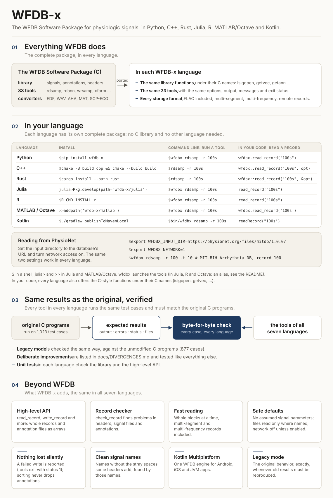

# WFDB-x
## A fast, lightweight implementation of the WFDB library and command-line tools, with identical behavior across seven programming languages

The [WFDB Software Package](https://physionet.org/content/wfdb/) (by George
B. Moody and contributors) is the reference C library and set of
command-line tools for reading, writing and converting physiologic signal
and annotation files, such as the PhysioNet databases. WFDB-x is a faithful
reimplementation of its version 10.7.0 in C++, Python, MATLAB/Octave, Rust,
Julia, R and Kotlin, so that developers can use the same files, the same
functions and the same tools without the C library.

WFDB-x is an independent project. It is not part of the
[WFDB project](https://wfdb.io/) or of PhysioNet, and is not endorsed by
them. It follows the WFDB format and the behavior of the original C
package; see [Related projects](#related-projects) for the official WFDB
software.

Each implementation:

* reads and writes **exactly the same files** as the original C library:
  headers (`.hea`), signal files in every WFDB storage format (8, 16, 61,
  80, 160, 212, 310, 311, 24, 32, and the FLAC formats 508/516/524),
  annotation files (MIT and AHA formats), EDF/EDF+, calibration and info
  files, and multi-segment records;
* provides the **same command-line tools** (33 of them, listed below), with
  the same options;
* provides the C library API, with the C function names (`isigopen`,
  `getvec`, `getann`, `putann`, `strtim`, ...), and a high-level API in the
  idiom of its language;
* is **lightweight**: no dependencies beyond the language's standard library
  (except NumPy for Python). FLAC is supported without libFLAC. Reading
  records from URLs uses the system `curl` program in C++ and Rust (and in
  R and MATLAB/Octave when it is installed).

The original C sources are kept, unmodified, in
[`third_party/wfdb-main.zip`](third_party/), and serve as the reference
implementation for testing.

## WFDB-x at a glance

[](docs/overview.svg)

(Also as a PNG image: [`docs/overview.png`](docs/overview.png).)

## Why WFDB-x

For more than four decades, the WFDB Software Package has been the common
ground of physiologic signal processing. PhysioNet distributes its
databases in WFDB format, and these databases are among the most widely
used in the field. Thousands of published studies, open-source tools and
machine-learning benchmarks rest on what the WFDB library returns when it
reads a record, and on what it writes.

Researchers work with these records in many languages. WFDB-x offers one
behavior across seven of them: it takes a single specification, the original
C package, and reimplements it in Python, C++, MATLAB/Octave, Rust, Julia,
R and Kotlin, **tested to be identical**, byte for byte, to the original and to
each other, for reading and for writing. A record read in Julia gives
exactly the samples it gives in C++, and a file written in R is exactly the
file the original tools write. Researchers can choose a language for their
work, and move between languages, with the same results. The Kotlin
implementation brings the same behavior to mobile applications (Android,
and iOS through Kotlin Multiplatform) and to the JVM.

## Deliberate differences from the original

WFDB-x behaves exactly as the original package, with a few deliberate
exceptions. They are the same in all seven languages and tested like
everything else:

* **No built-in signal parameters.** WFDB-x never assumes a sampling
  frequency, gain, ADC resolution or units that a record does not give.
  Tools that write them require them, for example
  `wrsamp -F 250 -G 200 -R 16 -U mV`.
* **Files are read and written only where they are named.** A full path,
  a `~` path or a URL is used as given. Any other name is read from the
  input directory and written to the output directory, which are both the
  current directory unless they are set. Nothing is searched.
* **Network access is off unless it is turned on.** To read from
  PhysioNet, set the input directory to the database's URL and turn
  network access on. For example, to print the first 10 seconds of record
  100 of the MIT-BIH Arrhythmia Database:

  ```sh
  export WFDBX_INPUT_DIR=https://physionet.org/files/mitdb/1.0.0/
  export WFDBX_NETWORK=1
  rdsamp -r 100 -t 10
  ```

* **Annotation files are sorted without losing annotations**, inside the
  library rather than by running a separate program.
* **A tool never writes a signal file over a signal file it is reading.**
* **A write error gives exit status 1.** When an output file or the
  standard output cannot be written, a tool says so and exits with status
  1, as the standard Unix tools do; the original exited with status 0.

[`docs/DIVERGENCES.md`](docs/DIVERGENCES.md) explains each difference and
the reasons for it. **Legacy mode** reproduces the original package
exactly, for reproducing old results: `--legacy` as the first argument of a
tool, or the legacy option of the library and of the high-level functions.

## What "identical behavior" means, and how it is checked

For the same input, a WFDB-x tool produces **byte for byte** the same
standard output, standard error (including error messages), exit status and
output files as the original C tool. The library functions return the same
values as their C counterparts. (The exceptions are the deliberate
divergences above; the reference results are produced by the C code with
these changes applied, so they are tested in the same way.)

This is verified by tests whose expected results were produced by the
original C code, not written by hand:

* **Conformance suite** ([`tests/conformance/`](tests/conformance/),
  described in [`docs/conformance.md`](docs/conformance.md)): 1098
  command-line test cases, run by a language-independent harness. Their
  expected results were produced by the C programs, built from
  `third_party/` with FLAC support and with
  [`tests/reference/divergences.patch`](tests/reference/divergences.patch)
  applied ([`tests/reference/build_reference.sh`](tests/reference/build_reference.sh)).
  The exceptions are 20 cases whose input makes the C programs crash; their
  expected results are the behavior that WFDB-x defines for that input (see
  [`docs/DIVERGENCES.md`](docs/DIVERGENCES.md#input-on-which-the-c-package-crashes)).
  Every implementation passes all of them on the reference platform, x86-64
  Linux with glibc (Python 3.13, GCC 13, Rust 1.97, Julia 1.13, R 4.3,
  GNU Octave 8.4 and OpenJDK 21 for Kotlin). The MATLAB/Octave code is tested with GNU Octave, also
  through the MATLAB driver (`matlab/bin/wfdbx_matlab.sh`); it is written
  for MATLAB too, but MATLAB itself has not been available to run the
  tests. Other platforms can differ where the C behavior depends on the
  platform (see [`docs/KNOWN_C_BEHAVIORS.md`](docs/KNOWN_C_BEHAVIORS.md)).
* **Test records** ([`tests/data/`](tests/data/)): written by the C library
  itself ([`tests/reference/gen_records.c`](tests/reference/gen_records.c)).
  They cover every storage format, multi-frequency and multi-segment (fixed
  and variable layout) records, skewed signals, byte offsets,
  block-structured files, EDF, and annotation files using every feature of
  the annotation format.
* **Library unit tests** in each language directory, with expected values
  printed by the C library
  ([`tests/reference/api_expect.c`](tests/reference/api_expect.c)).

A few behaviors of the C code are undefined (crashes or reads of
uninitialized memory), and many are surprising but well-defined. Both kinds
are documented in [`docs/KNOWN_C_BEHAVIORS.md`](docs/KNOWN_C_BEHAVIORS.md),
with the behavior WFDB-x chose where C's is undefined.

## Implementations

All seven implement the complete library and all 33 tools (see
[`docs/INVENTORY.md`](docs/INVENTORY.md) for the details). Each directory
has a README with installation instructions, usage examples and
requirements.

| Language | Directory and README | Install (from a copy of this repository) | Run a tool |
|---|---|---|---|
| Python | [`python/`](python/README.md) | `pip install wfdb-x` (PyPI), or `pip install ./python` | `wfdbx rdsamp -r 100s` |
| C++ | [`cpp/`](cpp/README.md) | `cmake -S cpp -B cpp/build && cmake --build cpp/build` | `rdsamp -r 100s` |
| MATLAB / GNU Octave | [`matlab/`](matlab/README.md) | `addpath('/path/to/wfdb-x/matlab')` (tested with GNU Octave; MATLAB untested) | `wfdbx rdsamp -r 100s` |
| Rust | [`rust/`](rust/README.md) | `cargo install --path rust` | `rdsamp -r 100s` |
| Julia | [`julia/`](julia/README.md) | `using Pkg; Pkg.develop(path="/path/to/wfdb-x/julia")` | `wfdbx rdsamp -r 100s` |
| R | [`r/`](r/README.md) | `R CMD INSTALL r` | `wfdbx rdsamp -r 100s` |
| Kotlin (Android, iOS, JVM) | [`kotlin/`](kotlin/README.md) | `cd kotlin && ./gradlew publishToMavenLocal`, then `implementation("io.github.alphanumericslab:wfdbx:1.1.0")` (Gradle, with `mavenLocal()`) | `kotlin/bin/wfdbx rdsamp -r 100s` |

Record `100s` is the sample record in `tests/data`. Run the tools there, or
point `WFDBX_INPUT_DIR` at that directory; the Python package also includes it
(see [`python/README.md`](python/README.md)).

In Julia, R and MATLAB/Octave, `wfdbx` is a short alias for the language's
own launcher of the tools; each README shows how to set it up. The Python
package is distributed on PyPI as `wfdb-x`, with example
notebooks and a sample record (`wfdbx --examples` copies the notebooks). In
code, the packages are named
`wfdbx` (Python, MATLAB, Rust, R, Kotlin, and the C++ namespace) or
`WFDBX` (Julia).

## Three ways to use WFDB-x

Every language offers the same three ways in. They are written natively in
the language, and none of them calls the C library or another language.

| | What it is | Use it for |
|---|---|---|
| **1. The high-level API** (recommended) | A few functions in the idiom of the language: `read_record`, `read_header`, `read_annotations`, `write_record`, `write_annotations` and `check_record` (`readRecord`, ... in Kotlin). One call reads a whole record or annotation file into arrays (NumPy, `Vector`, `matrix`, ...), with named options, errors reported as exceptions or error values, and fast block reads. | New code, analysis, notebooks, machine learning: anything that wants a record as arrays. It has no counterpart in the C package. |
| **2. The WFDB library functions** | The C library API under its C names (`isigopen`, `getvec`, `getann`, `putann`, `strtim`, ...), with the C behavior, frame by frame and annotation by annotation. | Porting a program written against the C library, or processing a record as a stream with the exact C semantics. |
| **3. The command-line tools** | The 33 tools (`rdsamp`, `rdann`, `wrsamp`, `xform`, ...) with the options, output, messages and exit status of the C tools, implemented in each language. | Shell scripts and pipelines, and reproducing work done with the original tools, without installing the C package. |

The high-level API is built on the library functions, and returns exactly
the samples and annotations that they (and the C library) give. The tools
are built on the library functions too. Each language's README shows all
three; see the table under [Implementations](#implementations) for how each
language runs the tools.

## Performance

[`docs/BENCHMARKS.md`](docs/BENCHMARKS.md) compares the speed and memory use
of the seven implementations, of the original C library and tools, and of
wfdb-python, on the same records and the same machine, verifies that they
all give identical results, and explains how to get the most speed from
WFDB-x in application code. In short:

* Rust, Julia and C++ are the fastest: an hour of a two-signal ECG is read
  in 4 to 6 ms, 4 to 7 times faster than with the C library (26 ms), which
  reads one frame per `getvec` call. The C library reads annotation files
  fastest.
* The C++ and Rust `rdsamp` print that hour 4 to 5 times as fast as the C
  `rdsamp`; the C tools start fastest (1.3 ms, against about 2 ms).
* Kotlin reads records 1.2 to 2.1 times slower than C++ (annotation files
  4 to 8 times).
* Python reads records at speeds close to those of wfdb-python and the C
  library (from 1.7 times slower than C to 2.4 times faster, depending on
  the record), and writes them 9 times faster than wfdb-python.
* R and MATLAB/Octave take 46 to 67 ms for that hour, fast enough for most
  records.

## Command-line tools

Signal and annotation tools from `app/`: `rdsamp`, `wrsamp`, `rdann`, `wrann`,
`sortann`, `ann2rr`, `rr2ann`, `wfdbdesc`, `wfdbtime`, `time2sec`, `sampfreq`,
`signame`, `signum`, `sigamp`, `snip`, `xform`, `wfdbcat`, `wfdbwhich`.

Format converters from `convert/`: `edf2mit`, `mit2edf`, `rdedfann`,
`wav2mit`, `mit2wav`, `wfdb2mat`, `a2m`, `m2a`, `ad2m`, `md2a`, `ahaecg2mit`,
`makeid`, `readid`, `revise`, `parsescp`.

The interactive viewer (WAVE), the plotting tools, and the analysis programs
of `psd/` are outside the scope of this project.

## Documentation

* [`docs/DIVERGENCES.md`](docs/DIVERGENCES.md): the deliberate differences
  from the original package, the reasons for them, and legacy mode
* [`docs/INVENTORY.md`](docs/INVENTORY.md): every tool and library
  function, with its status in each language
* [`docs/conformance.md`](docs/conformance.md): the conformance suite, and
  how to run it for any implementation
* [`docs/BENCHMARKS.md`](docs/BENCHMARKS.md): speed and memory use in each
  language, and how to read records fastest
* [`docs/RELEASING.md`](docs/RELEASING.md): how to release the Python
  package on PyPI (accounts, API tokens, TestPyPI, PyPI)
* [`docs/KNOWN_C_BEHAVIORS.md`](docs/KNOWN_C_BEHAVIORS.md): reproduced C
  behaviors, and the handling of undefined ones
* [`docs/porting-guide.md`](docs/porting-guide.md): architecture, and the C
  semantics that every implementation must reproduce
* [`docs/AUTHORS.md`](docs/AUTHORS.md): the authors of the C code that each
  part of WFDB-x ports
* The WFDB Applications Guide ([`third_party/wag.pdf`](third_party/))
  describes the tools, and the WFDB Programmer's Guide (in
  `third_party/wfdb-main.zip`) the library API; WFDB-x reproduces both.

## How WFDB-x was developed

WFDB-x was built through **AI-assisted development, cross-language
verification and unit testing**.

* **AI-assisted development.** We designed the project and its
  requirements: faithfulness to the original C package, identical behavior
  across languages, the testing methodology, and deliberate design
  decisions such as removing built-in signal parameters. We directed and
  reviewed the work. The code, tests and documentation were written with
  Claude Code, Anthropic's AI coding assistant, working from the original
  C sources, and were reviewed and tested by human engineers.
* **Cross-language verification.** Every implementation is checked
  against the outputs of the original C tools and library on the
  conformance suite: 1098 cases, plus 877 for legacy mode. Because all
  seven must pass the same cases, each implementation is also checked
  against the other six.
* **Unit testing.** Each implementation has its own unit tests of the
  library and of the high-level functions, with expected values printed by
  the C library.

Reports of any difference from the original package are welcome as GitHub
issues.

## Versions

WFDB-x has its own version numbers, shared by the seven implementations and
following [semantic versioning](https://semver.org); the current version is
1.1.0. They are independent of the version of the WFDB Software Package
that WFDB-x implements, 10.7.0, which the library still reports as in C
(`wfdbversion()` returns `"10.7.0"`, and `wfdberror()` names it).

## Related projects

These projects and initiatives are related to WFDB-x, which does not use or
depend on any of them. WFDB-x is a port of the original C package to other
languages, and the C programs produce the expected results of its tests.
The other projects are acknowledged as related work.

* **[The WFDB project](https://wfdb.io/)** maintains the WFDB format
  specification and the official WFDB software, and coordinates their
  development through its working group. WFDB was originally developed at
  MIT by George B. Moody in 1989, and builds on decades of work by him,
  Roger G. Mark and the broader research community.
* **[The WFDB Software Package](https://physionet.org/content/wfdb/)**, by
  George B. Moody, Benjamin Moody and contributors, distributed by
  [PhysioNet](https://physionet.org/): the original C library and tools.
  WFDB-x reimplements its version 10.7.0.
* **[WFDB Python](https://wfdb.io/software/python.html)** and the
  **[WFDB Toolbox for MATLAB](https://wfdb.io/software/matlab.html)**: the
  Python and MATLAB implementations of the WFDB project, alongside its
  C package.
* **[wfdbcheck](https://github.com/bemoody/wfdbcheck)**, by Benjamin Moody:
  a tool that finds common problems in WFDB records, from metadata errors
  to out-of-range samples and annotation errors.

## Authors and license

WFDB-x was developed by [Reza Sameni](https://sameni.info)
([GitHub](https://github.com/rsameni)) (2026), through
AI-assisted development, cross-language verification and unit testing (see
[How WFDB-x was developed](#how-wfdb-x-was-developed)). It is an
independent reimplementation of the WFDB Software Package: its code in each
language is a translation of the package's C code, written for WFDB-x, not
code by the original WFDB developers. The C library and tools were written
by George B. Moody, Benjamin Moody and the other contributors credited, file
by file, in each WFDB-x source file and in [`docs/AUTHORS.md`](docs/AUTHORS.md).

WFDB-x is distributed under the GNU General Public License, version 3 or
(at your option) any later version ([`LICENSE`](LICENSE)). The original C
sources in [`third_party/`](third_party/) keep their own licenses: the GNU
Library General Public License, version 2 or later, for the library, and
the GNU General Public License, version 2 or later, for the tools.

The original WFDB Software Package is Copyright (C) 1983-2022 George B. Moody
and the WFDB contributors.
